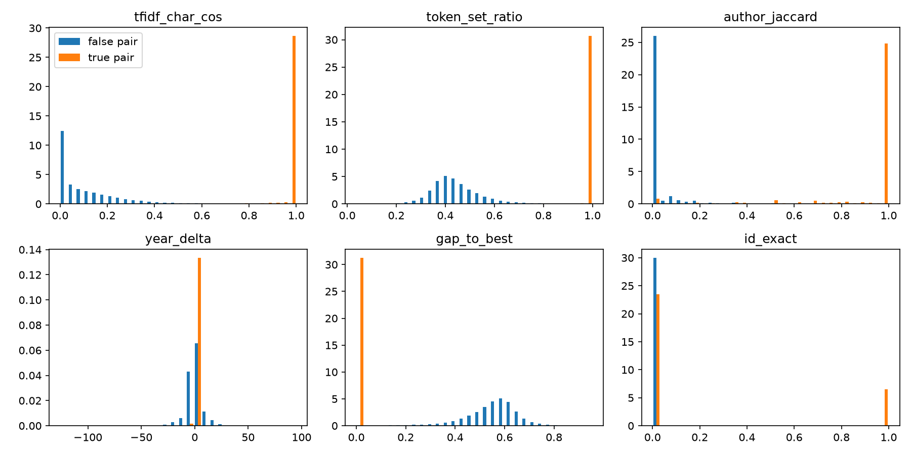
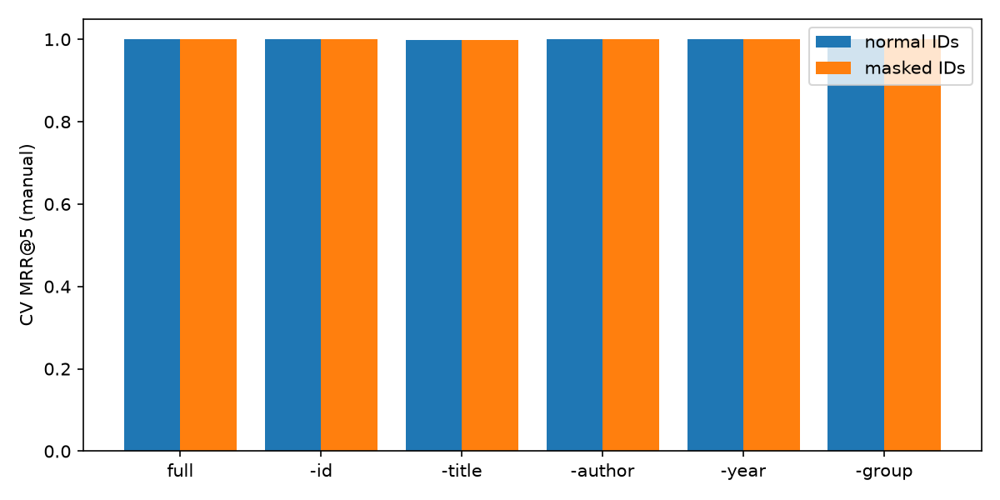

# Module C feature and model analysis

Generated 2026-11-24T17:49:19+00:00 from `runs/m3-delivery/model`.

## E1/E2 Valid MRR@5

| method | mode | all | manual | automatic |
|---|---|---|---|---|
| baseline | normal | 0.9780 (n=511) | 0.9741 | 1.0000 |
| baseline | masked | 0.9780 (n=511) | 0.9741 | 1.0000 |
| model | normal | 1.0000 (n=511) | 1.0000 | 1.0000 |
| model | masked | 1.0000 (n=511) | 1.0000 | 1.0000 |
| logistic | normal | 1.0000 (n=511) | 1.0000 | 1.0000 |
| logistic | masked | 1.0000 (n=511) | 1.0000 | 1.0000 |
| ranker | normal | 1.0000 (n=511) | 1.0000 | 1.0000 |
| ranker | masked | 1.0000 (n=511) | 1.0000 | 1.0000 |

## E1/E2 Test MRR@5 (run once after selection)

| method | mode | all | manual | automatic |
|---|---|---|---|---|
| baseline | normal | 0.9981 (n=528) | 0.9977 | 1.0000 |
| baseline | masked | 0.9981 (n=528) | 0.9977 | 1.0000 |
| model | normal | 1.0000 (n=528) | 1.0000 | 1.0000 |
| model | masked | 1.0000 (n=528) | 1.0000 | 1.0000 |
| logistic | normal | 1.0000 (n=528) | 1.0000 | 1.0000 |
| logistic | masked | 1.0000 (n=528) | 1.0000 | 1.0000 |
| ranker | normal | 1.0000 (n=528) | 1.0000 | 1.0000 |
| ranker | masked | 1.0000 (n=528) | 1.0000 | 1.0000 |

## E3 Ablation (CV on train)

| variant | normal all | normal manual | masked all | masked manual |
|---|---|---|---|---|
| full | 0.9999 | 1.0000 | 0.9970 | 1.0000 |
| -id | 0.9987 | 1.0000 | 0.9987 | 1.0000 |
| -title | 0.9992 | 0.9992 | 0.9972 | 0.9992 |
| -author | 0.9999 | 1.0000 | 0.9960 | 1.0000 |
| -year | 0.9999 | 1.0000 | 0.9963 | 1.0000 |
| -group | 0.9999 | 1.0000 | 0.9988 | 1.0000 |

## E4 Heuristic labels vs manual labels

Papers: 25; precision 0.9872; recall 0.9883; counts {'correct': 1858, 'missed': 22, 'correct_no_match': 373, 'false_match': 24}.

## E5 Valid errors

0 of 511 valid queries have a wrong top-1: {}.

## E6 Features

| feature | group | mean true | mean false | single-feature AUC | LR coef | LightGBM gain |
|---|---|---|---|---|---|---|
| id_exact | id | 0.2168 | 0.0000 | 0.6084 | 3.2443 | 35142.8006 |
| entry_has_id | id | 0.2168 | 0.2075 | 0.5046 | -0.8896 | 0.0321 |
| id_conflict | id | 0.0000 | 0.2075 | 0.3962 | -1.4527 | 2866.3887 |
| jaccard | title | 0.9788 | 0.0538 | 0.9964 | 1.8816 | 1842.0429 |
| contain_e_in_r | title | 0.9826 | 0.0958 | 0.9954 | -1.5120 | 103.6241 |
| contain_r_in_e | title | 0.9895 | 0.0963 | 0.9962 | -0.8230 | 2268.5426 |
| token_set_ratio | title | 0.9951 | 0.4462 | 0.9950 | -1.6262 | 154.3385 |
| partial_ratio | title | 0.9948 | 0.4759 | 0.9956 | 0.1350 | 307.2663 |
| tfidf_char_cos | title | 0.9871 | 0.1102 | 0.9957 | 1.5148 | 217.0080 |
| len_ratio | title | 0.9864 | 0.7094 | 0.9207 | 0.8848 | 2427.8865 |
| title_exact | title | 0.9431 | 0.0000 | 0.9715 | 1.0095 | 654.4087 |
| entry_title_missing | title | 0.0000 | 0.0000 | 0.5000 | 0.0000 | 0.0000 |
| first_author_match | author | 0.9650 | 0.0144 | 0.9753 | 0.1885 | 1469.4393 |
| author_jaccard | author | 0.9086 | 0.0234 | 0.9862 | 0.1206 | 696.6396 |
| author_overlap | author | 5.4194 | 0.2617 | 0.9722 | -0.0402 | 11.7083 |
| entry_authors_missing | author | 0.0020 | 0.0024 | 0.4998 | 0.0406 | 0.0000 |
| year_delta | year | 0.4111 | 0.4469 | 0.5073 | -0.1216 | 1759.3090 |
| abs_year_delta_le1 | year | 0.9193 | 0.3293 | 0.7950 | 0.8413 | 92.0345 |
| year_missing | year | 0.0097 | 0.0061 | 0.5018 | 0.1103 | 0.0000 |
| title_rank_in_entry | group | 1.0962 | 35.1458 | 0.0022 | 1.0600 | 3309531.6152 |
| gap_to_best | group | 0.0007 | 0.5502 | 0.0011 | -3.3166 | 160866.2523 |
| z_in_entry | group | 4.3392 | -0.0975 | 0.9956 | 1.1667 | 1084.5607 |
| mutual_best | group | 0.9907 | 0.0012 | 0.9947 | 0.2362 | 2.0776 |
| n_candidates | group | 45.4929 | 68.5983 | 0.3134 | -1.9573 | 297.6204 |

