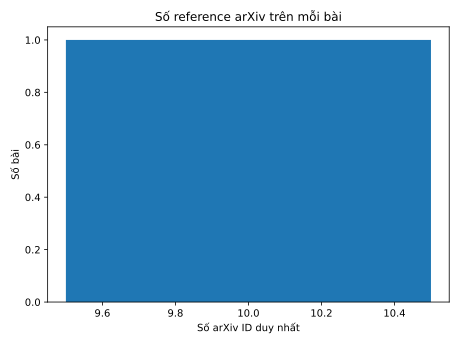
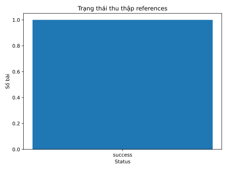

# 1.5 Thu thập tài liệu tham khảo (References)


> **Người phụ trách:** Mẫn Nhi (`@NhiNgo49`)  
> **Reviewer:** Hoàng (`huynhhuyhoang2006@gmail.com`)

---

## 1. Mục tiêu

T4 lấy danh sách tài liệu tham khảo của một bài báo từ Semantic Scholar Graph API, giữ lại bản ghi gốc đã nhận, chuẩn hóa các reference có arXiv ID và bổ sung ngày nộp phiên bản đầu từ arXiv API. Kết quả được lưu trong `Result` với `step="references"` theo schema 1.2.

## 2. Nguồn dữ liệu

| Nguồn | Dữ liệu sử dụng | Lý do |
|---|---|---|
| Semantic Scholar Graph API | Danh sách references, thông tin cited paper và `next` để phân trang | Cung cấp các mục tài liệu tham khảo của bài báo |
| arXiv Atom API | Trường `published` cho các arXiv ID được trích dẫn | Xác định ngày nộp v1 từ nguồn arXiv |

Ngày nộp được lấy từ arXiv API, không dùng `publicationDate` của Semantic Scholar và không suy ngày từ ID. `ArxivDateClient` chỉ trả ngày cho các ID nằm trong batch đã hỏi; ID không xuất hiện trong phản hồi không được tự động kết luận là không tồn tại.

## 3. Quy trình

```{mermaid}
flowchart TD
    A["PaperTask: owner + arxiv_id"] --> B["Semantic Scholar: page offset=0"]
    B --> C["Lưu raw page"]
    C --> D{"Có next offset?"}
    D -->|Có| E["Request trang tiếp theo"]
    E --> C
    D -->|Không| F["Gộp và chuẩn hóa references"]
    F --> G["Giữ ID arXiv hợp lệ"]
    G --> H["Batch tra ngày published từ arXiv API"]
    H --> I["Bổ sung submission_date"]
    I --> J["Tính missing_fields và metrics"]
    J --> K["Result: success / partial / empty"]
```

### 3.1. Phân trang Semantic Scholar

`SemanticScholarClient.references_page(arxiv_id, offset, limit)` gọi endpoint references của Graph API. Mặc định `page_size=100`, `max_pages=50`. Phản hồi phải là JSON object có trường `data` kiểu danh sách. Trường `next` phải là số nguyên lớn hơn offset hiện tại; nếu không có `next`, module xem như đã đến trang cuối.

Mỗi trang hợp lệ được sao chép vào `raw_references` theo thứ tự nhận được. Bản raw giữ các object gốc, kể cả mục không có arXiv ID, `citedPaper=null` và các mục trùng. Việc giữ raw giúp phân biệt số mục nguồn trả về với số ID arXiv duy nhất sau chuẩn hóa.

### 3.2. Chuẩn hóa và khử trùng

Module chỉ tạo `references` cho ID arXiv hợp lệ. Quy trình chuẩn hóa ID bao gồm bỏ khoảng trắng, tiền tố `arXiv:` và hậu tố phiên bản `vN`; ID cũ dạng phân lớp như `math.GT/0309136v2` được chuẩn hóa về `math/0309136`. ID không hợp lệ bị loại khỏi dictionary `references` nhưng vẫn thuộc số mục nguồn thô.

Các bản ghi trùng được gộp theo ID arXiv chuẩn. Với từng trường, module giữ giá trị không thiếu đầu tiên; không ghép danh sách tác giả từ nhiều bản ghi. Các xung đột được ghi vào `provenance`. Tiêu đề và danh sách tác giả rỗng được xem là thiếu.

### 3.3. Bổ sung ngày nộp

Các ID arXiv sau chuẩn hóa được chia batch tối đa 100 ID để tra `published` từ arXiv Atom API. Ngày chỉ được chấp nhận nếu thuộc batch được yêu cầu và có định dạng ISO hợp lệ: ngày `YYYY-MM-DD` hoặc timestamp có múi giờ. Giá trị không hợp lệ được xem là thiếu và xuất hiện trong `missing_fields`.

### 3.4. Trường dữ liệu và metrics

`Result.data` của T4 có ba trường quan trọng:

| Trường | Ý nghĩa |
|---|---|
| `raw_references` | Các mục gốc từ những trang Semantic Scholar đã chấp nhận, giữ thứ tự và duplicate |
| `references` | Dictionary theo arXiv ID đã chuẩn hóa, gồm `title`, `authors`, `submission_date`, `semantic_scholar_id` |
| `complete` | `true` khi đã lấy hết các trang Semantic Scholar; không có nghĩa mọi metadata đều đầy đủ |

Metrics gồm:

- `s2_reference_count`: số mục nhận được trước lọc và khử trùng; bằng `len(raw_references)`.
- `arxiv_reference_count`: số arXiv ID hợp lệ, duy nhất; bằng số key của `references`.
- `complete_reference_count`: số reference arXiv có đủ bốn trường metadata bắt buộc.

Bất biến cần giữ: `complete_reference_count <= arxiv_reference_count <= s2_reference_count`.

## 4. Quy tắc status

| Tình huống | Status | `data.complete` | Diễn giải |
|---|---|---:|---|
| Đã hết trang, có references arXiv và mọi trường bắt buộc đầy đủ | `success` | `true` | Lấy xong và metadata đầy đủ |
| Đã hết trang nhưng có trường metadata thiếu | `partial` | `true` | Phân trang xong, metadata chưa đầy đủ |
| Đã hết trang, không có reference arXiv hợp lệ | `empty` | `true` | Không có mục arXiv sau chuẩn hóa |
| Lỗi ở trang sau trang đầu | `partial` | `false` | Giữ các trang đã nhận, còn thiếu trang |
| Lỗi ngay trang đầu | `failed` hoặc `not_found` | Không có data | Không có dữ liệu trang được chấp nhận |
| Đạt giới hạn 50 trang khi còn trang tiếp | `partial` | `false` | Lỗi có thể retry; chạy lại để tiếp tục |

Lưu ý: `empty` không chứng minh bài báo không trích dẫn tài liệu nào; nó chỉ mô tả kết quả sau khi lọc về các ID arXiv hợp lệ.

## 5. Rate limit và retry

Client Semantic Scholar mặc định chờ 1 giây giữa các request, timeout 30 giây và tối đa 3 lần gửi cho một request. Client arXiv mặc định chờ ít nhất 3 giây. HTTP 429 được nhận diện là `rate_limited`; các lỗi server 500/502/503/504 và lỗi mạng có thể retry. `Retry-After` được đọc ở dạng số giây hoặc HTTP-date.

Nếu chạy qua runner, `RequestScheduler` có thể lưu lịch request và cooldown vào checkpoint store. Điều này giúp giữ deadline chờ qua lần restart thay vì gửi request quá sớm sau khi chương trình khởi động lại.

## 6. Resume và cache

T4 dùng chung hợp đồng `CheckpointStore` (`load(namespace, key)`, `save(record)`, `delete(namespace, key)`). Hai namespace chính:

| Namespace | Nội dung |
|---|---|
| `references` | Các trang đã nhận, offset, next offset và thời điểm lấy |
| `arxiv_dates` | Ngày nộp v1 đã xác minh của từng arXiv ID |

Key trang gồm owner, arXiv ID, page size và fields. Cache ngày dùng key `[arxiv_id]`; `run_id` được cô lập ở tầng store. Khi resume, `max_pages` chỉ đếm trang tải mới trong lượt hiện tại, nên chương trình có thể tiếp tục sau khi đã lưu 50 trang trước đó. Checkpoint sai schema hoặc sai identity phải báo lỗi rõ ràng, không được âm thầm xem như cache rỗng.

## 7. Giới hạn của số liệu trong bản repository hiện tại

Run `baseline-001` trong ZIP được cung cấp có `is_mock=true`. Bản ghi T4 mẫu thể hiện 15 mục Semantic Scholar, 10 arXiv ID duy nhất và 10 reference đủ metadata; đây là dữ liệu mô phỏng dùng kiểm tra luồng, không phải kết quả crawl thật. Các lần truy vấn trực tiếp được ghi trong README dự án có trước thay đổi schema raw 1.2; không dùng chúng làm xác nhận thực nghiệm mới cho phiên bản hiện tại.


## 8. Biểu đồ từ run được cung cấp

Dữ liệu hiện có trong ZIP là `baseline-001` với `is_mock=true`. Sau khi chạy script chuẩn bị dữ liệu và sinh SVG, hai biểu đồ sau minh họa đúng bản ghi mock hiện có; không được dùng chúng như kết quả crawl thật.





